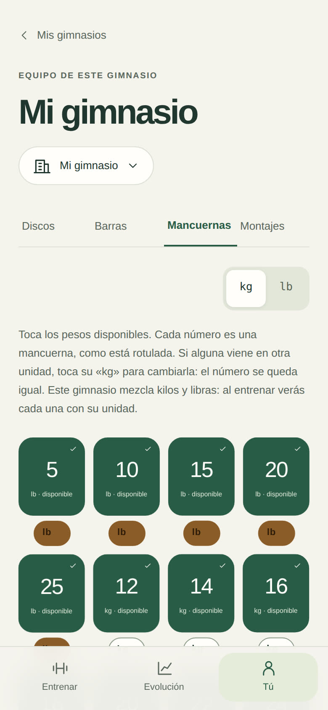
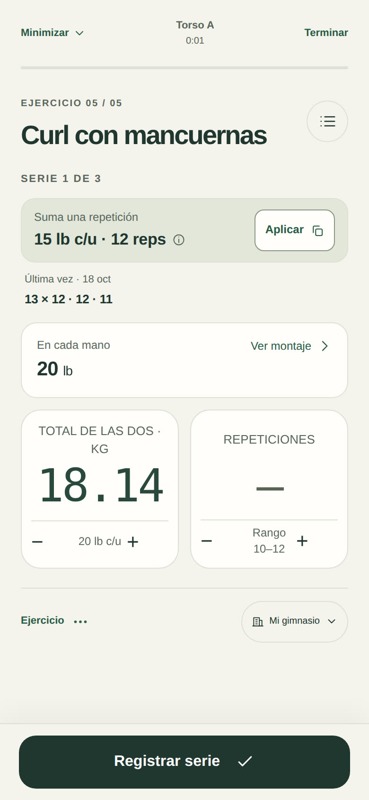
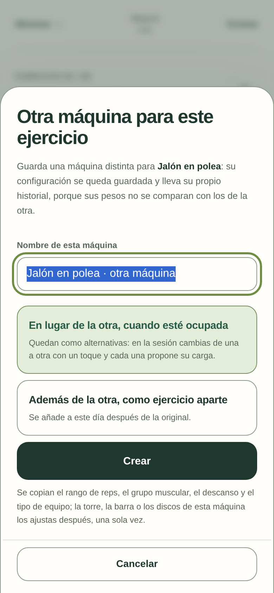
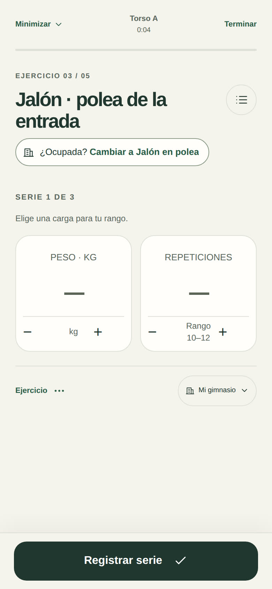
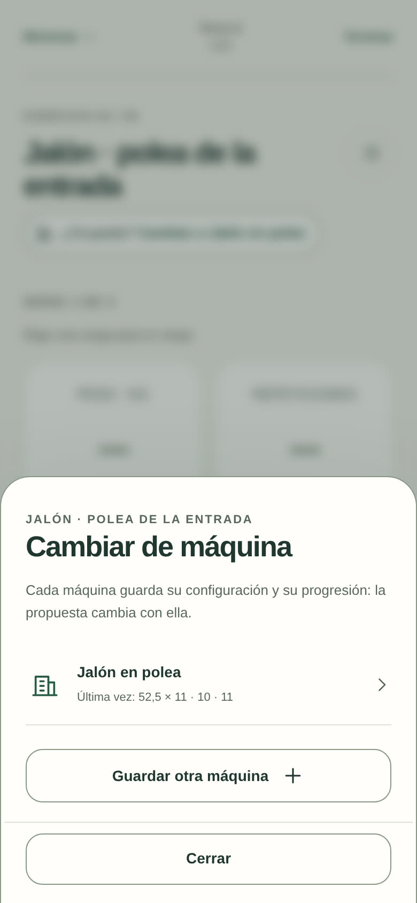

# Hierro Beta 3.19.0 · mancuernas en kilos y libras, y máquinas alternativas

## Mancuernas con su propia unidad

Hay gimnasios con las mancuernas chicas en libras y las grandes en kilos. Antes la app obligaba a elegir una sola unidad para todo el rack.

- **Cada mancuerna lleva su unidad.** En Mi equipo → Mancuernas, debajo de cada una hay un botón «kg» o «lb». Tocarlo cambia la unidad y **conserva el número rotulado** (una «10» pasa de 10 kg a 10 lb). Las que están en otra unidad que la del gimnasio se marcan en ámbar.
- **Al añadir** una mancuerna se elige su unidad, y **«Generar un rango»** tiene unidad propia y la opción «Añadir a las que ya tengo», para crear primero las de 5–25 lb y luego las de 12–40 kg.
- **Al entrenar, cada mancuerna se nombra como está rotulada:** la propuesta dice «15 lb c/u · 12 reps», el montaje «En cada mano: 20 lb», y debajo del campo de peso aparece «20 lb c/u». Las series hechas y el diario también («15 lb c/u × 10»).
- **+ y − saltan de mancuerna en mancuerna**, por las que existen de verdad, aunque se cambie de libras a kilos a mitad del rack.
- Por dentro todo sigue en kilos: la progresión elige la mancuerna real más cercana, sea de una unidad o de la otra.

## Máquinas alternativas

En un gimnasio puede haber varias máquinas para el mismo ejercicio que progresan distinto, por ejemplo dos poleas al fondo iguales y otras dos con otra torre. Antes, al cambiar de máquina había que volver a configurarla cada vez.

- **«Es otra máquina»** (en el equipo del ejercicio) y **«Cambiar de máquina»** (en las opciones del ejercicio durante la sesión) guardan otra máquina para ese ejercicio. Por defecto queda **«En lugar de la otra, cuando esté ocupada»**; la opción anterior, «Además de la otra», sigue disponible.
- Cada máquina guarda **su configuración por gimnasio** y lleva **su propio historial y su propia progresión**, porque sus pesos no se comparan.
- En la sesión aparece **«¿Ocupada? Cambiar a…»**. Un toque pasa a la otra máquina con su propuesta y lo ya calentado. Si ya hiciste series, esas se quedan con la primera máquina y las que faltan pasan a la otra; al guardar, cada una tiene sus series.
- La lista para cambiar muestra la última vez de cada máquina.

## Verificación

`node tests/run.js` incluye la suite «3.19.0 — mancuernas en kilos y libras, y máquinas alternativas»: nombres por unidad, cambio de unidad conservando el número, añadir con unidad, propuestas y diario con la mancuerna real, + y − por las que existen; crear la alternativa sin añadirla al día, cambiar en la sesión recuperando la configuración, cambiar a mitad del ejercicio repartiendo las series y que cada máquina progrese con su historial.
